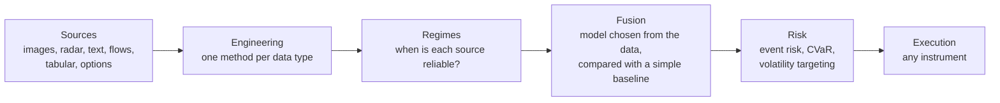

# Architecture: one discipline for many ideas

The repository supports a multilayer research system for alternative data. The system does not depend on the asset class: the same layers apply to energy, equities, rates, agriculture or options.

## Principle

> Data can be bought; the edge has to be built.

Test the free source first. Processed data that a vendor already sells (a tank fill level, a footfall index, a shipping flow) is bought only where it closes a measured gap in accuracy, freshness or coverage, at a cost below its marginal value. The trading signal is built: it comes from fusing several sources, from knowing when a source is wrong, from speed of integration and from risk management around events.

## Layers

| Layer | Question | Status |
|---|---|---|
| Sources | Which measurement exists already, processed, and what is free to prototype? | changes per idea |
| Engineering | How is each data type read? | changes per data type |
| Regimes | When is a source reliable (cloud cover, radar revisit, curve state, volatility regime)? | changes per idea; may be absent |
| Fusion | How are sources combined into one forecast of the decision variable? | chosen per idea |
| Risk | How large is the position, and what is the loss at the event? | constant |
| Validation | Is the result real? Availability timestamps, a simple baseline, a frozen holdout, written stop criteria, costs and capacity from day one. | constant |

Risk and validation are never removed. Pillars may be added, changed or removed per project.

## Fusion rule

The fusion model is chosen after examining the data (volume, structure, noise) and justified by the decision to be taken. It can be sophisticated, including custom, but it is always compared out of sample with a simple baseline, and it is retained only if it beats it.

## Data type, engineering method, processed data to buy, free prototype

| Data type | Examples | Engineering | Processed data (to buy) | Free prototype | Pitfalls |
|---|---|---|---|---|---|
| Optical images | tanks, car parks, crops | vision: detection and segmentation, shadows, vegetation indices | Kayrros, Orbital Insight, RS Metrics, Planet | Sentinel-2, Landsat | clouds, resolution, revisit |
| Radar (SAR) | floating roofs, through clouds | signal processing and CNN | Kayrros, Ursa Space, ICEYE | Sentinel-1 | speckle, geometry, revisit of 6 to 12 days |
| Text | filings, calls, news | NLP: embeddings, fine-tuned transformers, supervision on returns | RavenPack, LSEG, Bloomberg | SEC EDGAR | look-ahead in LLMs, decay |
| Positions and flows (sequences) | AIS tracks, card transactions, app usage | sequence models (GRU, transformer, state space) | Kpler, Vortexa, Consumer Edge, Earnest, Sensor Tower | none | panel drift, coverage |
| Geolocation | store visits | panel normalisation, trees or linear models | Placer.ai, Advan | none | panel, terms of use |
| Tabular and series | weather, stocks, fundamentals | gradient-boosted trees, ridge, Kalman filters | ECMWF, Montel | Open-Meteo, EIA, ENTSO-E, AGSI+ | revisions, point-in-time |
| Options | implied-volatility surfaces | parametric surfaces and ML | OptionMetrics, ORATS | CBOE indices | stale quotes |

Vendors are market examples; no claim is made about their clients.

## Where the edge is built

1. Fusion of sources: no single measurement carries the whole signal.
2. Knowing when a source is wrong: observability regimes (clouds, revisit gaps) change the noise of each measurement.
3. Speed of integration: the measurement is available before the official figure.
4. Risk around events: scheduled releases are known in advance, so the position and the loss at the event can be sized.

## Origin

The structure follows the architecture of an earlier portfolio-allocation project (alternative-data features, regime detection and CVaR risk, fused by a learned policy). Only the architecture is reused.
